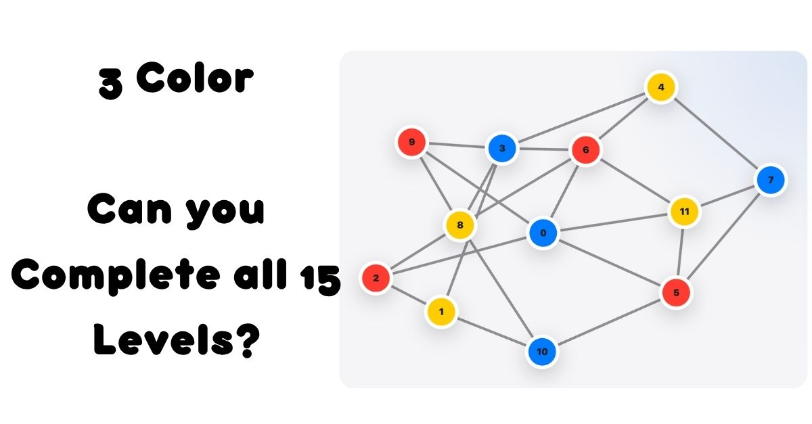

# 3Color

3Color is an interactive browser puzzle game based on the graph 3-coloring problem.

**Live Site:** https://3color.app/



## Overview

The goal of 3Color is simple: color every circle so that no two connected circles have the same color. The game starts with easier puzzles and gradually introduces more complex graphs that require more careful planning.

This project was built to make graph coloring more visual, playable, and accessible to people without a computer science background.

## Features

- 30 progressive campaign levels
- Random graph mode
- Conflict detection
- Recolor, reset, and timer tracking
- Mobile-friendly layout
- Social sharing preview and analytics

## Tech Stack

- React
- Vite
- JavaScript
- CSS
- Vercel

## Background

This project grew out of an earlier 3-coloring algorithm project, where I explored approaches to graph coloring. I built this interactive version to make the concept more visual, playable, and accessible to people without a computer science background.

## Running Locally

Clone the repository:

```bash
git clone https://github.com/DialoSall/3Color-Simulator.git
```

Move into the project folder:

```bash
cd 3Color-Simulator
```

Install dependencies:

```bash
npm install
```

Start the development server:

```bash
npm run dev
```

Create a production build:

```bash
npm run build
```

Preview the production build locally:

```bash
npm run preview
```

## Mobile Testing Locally

To test the local development version on a phone connected to the same WiFi network:

```bash
npm run dev -- --host 0.0.0.0
```

Then open the network URL shown in the terminal on your phone.

## Sharing a Puzzle

In **Generate Random Puzzle**, select **Share Puzzle** to copy a link for the
current graph. If clipboard access is unavailable, select and copy the displayed
link. Opening it loads the same node coordinates, connections, and canvas size,
with all circles uncolored and progress reset. No database or account is needed.

Links use `/custom?seed=…`; `/?seed=…` also opens the shared puzzle. Invalid or
unsupported links show a message and fall back to a random puzzle. Generating a
new graph clears the old seed from the address bar.

`src/utils/graphSharing.js` exports `serializeGraph(graph)`,
`deserializeGraph(seed)`, `createPuzzleUrl(graph, baseUrl)`, and
`readSharedPuzzle(search)`. The versioned binary format supports 3–24 vertices,
unique integer IDs from 0–65535, and coordinates within a positive canvas no larger
than 10,000 per dimension. It preserves floating-point coordinates exactly and
stores undirected connections as bits, yielding URL-safe seeds of 98–647 characters.
Puzzle colors, names, themes, and play progress are not encoded.

Run the sharing checks with `npm run test:sharing`.

## Appearance and Dense Graphs

- Choose **Light**, **Dark**, or **System** in the header. The choice is saved on
  this device; System follows changes to the device's appearance. Puzzle color
  themes and saved progress are independent of this setting.
- Hover over a circle on desktop, or press and hold on a touchscreen, to trace its
  connections. Other edges fade and connected circles are outlined. Releasing a
  hold does not color the circle or affect the timer/recolor count. Moving your
  finger cancels the hold so you can scroll normally.
- Focus a circle with the keyboard to trace connections; Enter or Space cycles
  its color.
- Use **+** and **−** to zoom in 10% steps from the fitted graph size, scroll inside the canvas to explore, and select
  **Fit** to restore the whole graph. **Expand** opens the puzzle in full screen
  on supported browsers; Exit or Escape returns to the page. Completing a puzzle
  also returns to its completion card.
- The campaign level picker and puzzle color/sound settings are collapsed while
  playing. Open **Choose a level**, **Puzzle colors**, or **Colors & sound** when
  needed. Puzzle coordinates, connections, and unlock rules are unchanged.

## Future Improvements

* Daily puzzles
* Shareable completion results
* More campaign levels
* Improved challenge tracking
* Optional leaderboard or community puzzle system

## Author

Built by [Dialo Sall](https://github.com/DialoSall).


